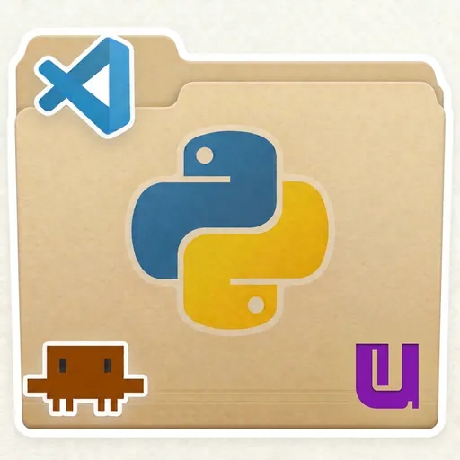
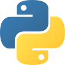

# init-python-pro

Un complemento de Claude Code que crea un proyecto Python profesional con **un solo comando**: `/python-pro:init`.

Te deja, listo para usar:

- **uv** para el entorno y las librerías, con un comando corto para arrancar: `uv run start`.
- **pytest** con una primera prueba, y **Ruff** para dar formato y revisar el código.
- **Git** (y, si quieres, un repositorio en GitHub).
- **Cuadernos Jupyter**, si los pides: carpeta `notebooks/`, núcleo en el entorno y resultados de las celdas fuera de Git.
- **VS Code** configurado: botones de ejecutar y depurar, formato al guardar y extensiones recomendadas.
- **Reglas de trabajo para Claude** dentro del propio proyecto: una guía de estilo de código, diseño documentado antes de programar, pruebas primero y dos formas de refactorizar (automática o interactiva).

## Para empezar

- 📦 [Instalación](docs/instalacion.md): casi nada que preparar. Solo Claude Code y VS Code.
- 🚀 [Uso](docs/uso.md): cómo crear un proyecto y cómo se trabaja después.
- 💡 [**De script a proyecto: Python profesional sin magia**](https://clamaveruma.github.io/init-python-pro/): una guía ilustrada, en ocho pasos, para quien sabe Python básico y quiere dar el salto. Explica por qué existen los entornos virtuales, cómo los usa VS Code, qué es `pyproject.toml`, cómo arrancar un programa, Git y el día a día.

---

© 2026 Claudio M. Martínez Velasco (<a href="https://github.com/clamaveruma">@clamaveruma</a>) · Licencia <a href="LICENSE">MIT</a>
